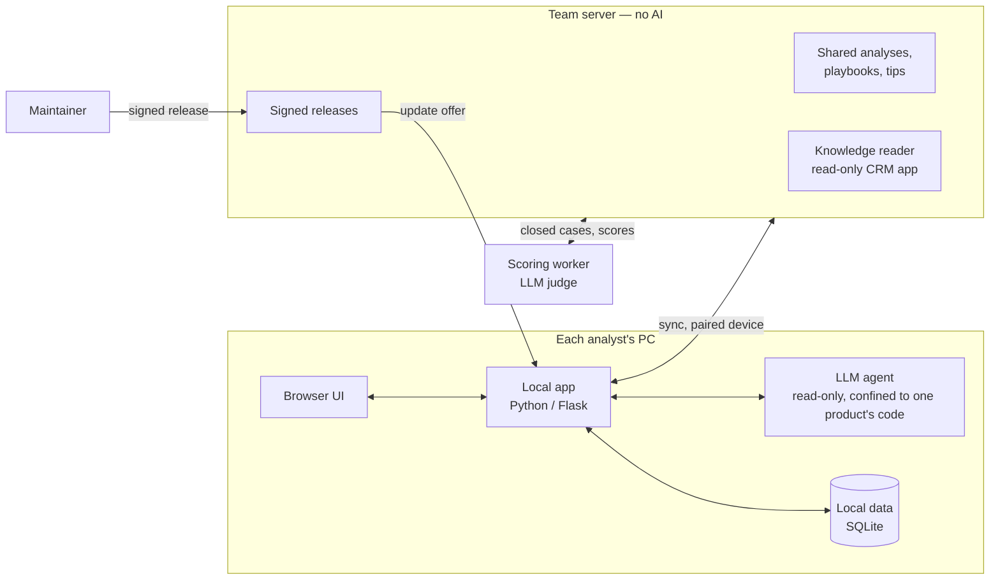

# Orbit — an AI copilot for support cases

**Role:** designer and lead developer, end to end (2025 – present). Rolled out to the support team across several
enterprise ERP product lines; maintained with a second maintainer.

## The problem

Support analysts work cases across several large ERP products. Answering one well means reading a long e-mail
thread and screenshots, remembering how similar cases were solved, and often tracing the cause through a large
codebase, then writing a careful reply to the customer. Much of that time goes into finding things, not deciding.

## What Orbit does

An analyst opens a case and Orbit:

1. **Reads the whole case**: the thread, attached screenshots and documents, the customer's earlier cases, and what
   changed since the last look.
2. **Finds what the team already knows**: similar past fixes, published knowledge articles, team playbooks and
   product help, matched to the case.
3. **Decides how deep to go**: a short first read routes the case: code needed, code not needed, or information
   missing. A how-to question is answered from the help without reading code, which costs much less.
4. **Analyses it with an LLM agent** (Claude Code or Grok) that may open only that product's code, read-only, with
   no commands and no network tools.
5. **Gives a decision, not a list**: a classification and verdict with a confidence, each problem the customer
   reported with its expected resolution, the most likely cause and the one check that rules it out, a risk card
   ("Before you act": what the fix changes and how to undo it), and a customer reply in Simplified Technical
   English that promises no dates and says only what was confirmed.
6. **Keeps going in a chat** that re-reads the case and can search the code, for follow-up questions or a shorter
   reply.

Nothing reaches a customer and nothing changes in another system without the analyst seeing it first and
confirming.

## Architecture

- **The AI runs only on analysts' machines** (and one scoring worker), each with its own account. The team server
  holds no model: it shares work, fetches knowledge articles and closed-case history read-only, and distributes
  releases.
- **Products are configuration, not code.** Each product is a folder: a manifest (its name, code repositories,
  help, settings) plus notes the agent reads. Adding a product needs no code change; an onboarding wizard drafts a
  product's profile from its repositories and documents for review. Product-specific rules live in that manifest,
  never as `if product == …` in shared code.
- **Updates are signed.** Each maintainer signs releases with their own key; every machine checks the signature
  before installing and every file after, backs up its data, and rolls back on its own if a new version does not
  start cleanly. Unattended machines install updates once nothing is running.
- **Content travels without releases.** Approved playbooks, tips and the team's tools catalog reach every machine at
  its next sync, so only code changes need a release.

## Measuring quality

- **A judge for closed cases.** When a case closes, a scoring worker compares Orbit's analysis with the case's whole
  history and how it was actually resolved, scores it, and classifies any gap: missing information, missing
  knowledge, or reasoning. Re-judging with the full history instead of the closing note changed no score by more
  than one point on a 0–3 scale, and separated "Orbit was wrong" from "the deciding fact arrived later".
- **Gaps become playbooks.** A case Orbit missed for lack of knowledge becomes a playbook draft; once a reviewer
  approves it, every machine has it at its next sync.
- **Benchmarks before changes.** A harness re-runs frozen real cases to compare models, prompts and settings on
  quality and cost. Changes ship only when measured: analysis cost fell by about 20% with no quality loss, and
  retuning the first read raised correct routing from 56% to 78%.

## Safety

- Read-only tools, confined to the case's own code; credentials and personal data scrubbed from what is shared.
- Customer data stays on the analysts' machines and the team server; no customer data in the repository.
- Per-product rules: for example, the order a resolution follows (the product's screens first, then a data
  correction, then a code change), set in each product's manifest.
- Every outward action, such as raising a development work item, shows a preview and waits for the analyst's
  confirmation.

## Engineering

| Area | What I used |
| --- | --- |
| Application | Python, Flask, Socket.IO, SQLite, vanilla JavaScript |
| AI | Claude Code and Grok CLIs as agents, MCP servers, prompt design, LLM-as-judge |
| Search | Word-index (TF-IDF) retrieval, optional local embedding model |
| Quality | About 2,200 unit tests and 380 browser tests (pytest, Playwright), mutation checks on new rules |
| Delivery | Signed releases, automatic update and rollback, Windows scheduled tasks |
| Process | Pull requests with review, a secret scan on every commit, two-maintainer releases |

## What I learned

- An LLM's output needs a human checkpoint exactly where it leaves the tool: a confident analysis reads as finished
  work to the next person.
- Measure the matcher you actually ship: a playbook can be right and still never be offered, because of how it is
  worded.
- The cheapest reliable speed-up was routing: deciding early that a case does not need the code at all.
